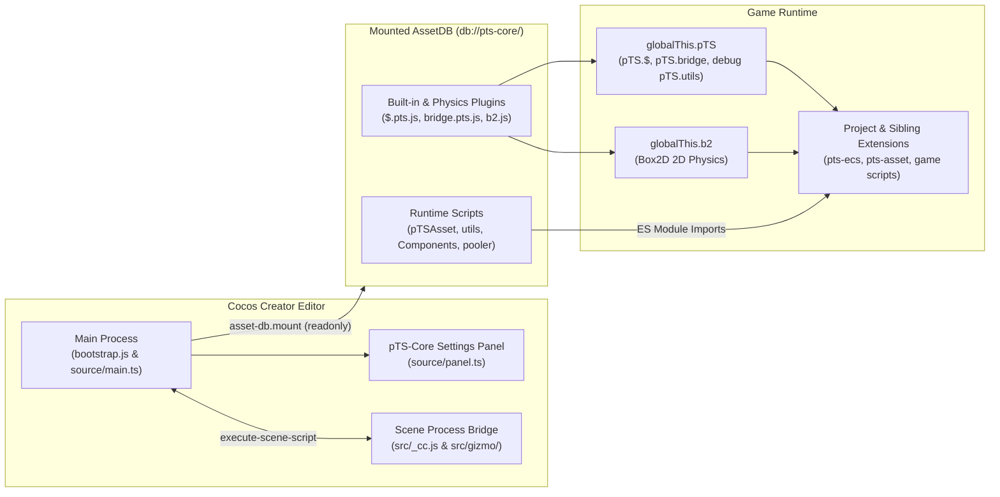

# pTS-Core

The foundational runtime and editor extension for the **pTS** ecosystem in **Cocos Creator 3.8.8+**. It provides the global `pTS.$` event/cache primitives, the `pTS.bridge` sync/async reactive store, the `pTSAsset` ScriptableObject base class and decorators, a modular `utils` library, ready-to-use Cocos UI/Renderer/Controller/Handler/Event/Smart components, Box2D 2D physics bindings, object pooling, and a Scene reflection & Gizmo bridge.

---

## Features

- **Global `pTS.$` Runtime Primitives**: Zero-dependency `eventify` (linked-list event emitter, class decorator, or instance enhancer) and `cache()` (V8 dictionary-mode null-prototype table).
- **Reactive `pTS.bridge` Store**: Global key-value data bridge with `get` / `set` / `add`, bulk multi-key access, `on` / `once` / `off` / `clear` lifecycle events, and `bridge.replican(...)` for spawning isolated sync or async stores.
- **`pTSAsset` & Contract Decorators**: ScriptableObject-style `cc.Asset` base class (`pTSAsset`, `pTSAsset.Data`, `pTSAsset.Event`) with `@menu` / `@pTSAsset.menu` (safely guarding `_decorator.menu` against Cocos warning `3623`), `@implement` / `imps` runtime contract checking, and `@gizmo` / `EditorGizmo`.
- **Modular Utility Library (`db://pts-core/scripts/utils`)**: `pArray`, `pAsync`, `pClass`, `pConst`, `pDriver`, `pECS`, `pEngine`, `pGizmo`, `pGlobal`, `pLazy`, `pMath`, `pObject`, and `pString`.
- **Rich Cocos Component Suite**: Prebuilt **UI** (`UI.DualScroller`, `UI.Data.Displayer`), **Renderer** (`MaskPolygon`, `MeshPolygonSprite` with custom editor gizmos), **Controller** (`Controller.Physics2DSystem`), **Handler**, **Event**, **Smart**, **Config**, **Data**, **Dom**, **Parameter**, and **Shared** components.
- **Box2D 2D Physics Plugin**: Bundled `physics_2d/b2.js` runtime plugin paired with `Controller.Physics2DSystem`.
- **Editor Settings & Scene Bridge**: Dockable **pTS-Core Settings** panel (`implement_check` toggle in Project Settings) and `src/_cc.js` scene-process bridge for class/component reflection, AnimGraph inspection, and custom SVG gizmos.

---

## Requirements

- **Cocos Creator**: `>= 3.8.8`
- **Node.js**: Required only when building extension TypeScript sources (`source/` -> `dist/`) or running regression tests.

---

## Installation & Setup

1. Copy the `pts-core` folder into your project's `extensions/` directory:
   ```text
   <your-project>/extensions/pts-core
   ```
2. Build the extension (if `dist/` is not already compiled):
   ```bash
   cd extensions/pts-core
   npm install
   npm run build
   ```
3. Enable **pts-core** in Cocos Creator via **Extension → Extension Manager**.
4. Configure optional settings via **Extension → pTS-Core → Settings** or **Project → Project Settings → pTS Core** (`Implement Check`).

> All scripts and plugins under `assets/` are automatically mounted read-only into Cocos Creator's Asset Database as `db://pts-core/`.

---

## Architecture Overview



---

## Safe Plugin Architecture

`pts-core` ships built-in runtime plugins under `assets/plugins/buitin/` (`$.pts.js`, `bridge.pts.js`) that initialize before regular ES modules across **Editor**, **Web**, **Native**, **Preview**, and **MiniGame** targets.

To avoid leaking local symbols or breaking across different JS engines and Cocos Creator's enclosed plugin sandbox, both scripts follow two strict conventions:

1. **Cross-Environment Root IIFE**:
   ```js
   (function (root) {
       "use strict";
       // Attach to root.pTS.$ / root.pTS.bridge
   })(
       typeof globalThis !== "undefined"
           ? globalThis
           : (typeof window !== "undefined"
               ? window
               : (typeof self !== "undefined" ? self : this))
   );
   ```
2. **Enclosed Plugin Metadata (`.js.meta`)**:
   ```json
   {
       "isPlugin": true,
       "loadPluginInEditor": true,
       "loadPluginInWeb": true,
       "loadPluginInNative": true,
       "loadPluginInPreview": true,
       "loadPluginInMiniGame": true,
       "executionScope": "enclosed",
       "simulateGlobals": ["window", "self", "global"]
   }
   ```

The Box2D plugin (`assets/plugins/physics_2d/b2.js`) uses `"executionScope": "global"` with `"simulateGlobals": ["b2"]` so `b2` is exposed globally to `Controller.Physics2DSystem` and physics extensions.

---

## Core Subsystems

### 1. Built-in Globals (`assets/plugins/buitin/`)

| Global | Typings | Purpose |
| :--- | :--- | :--- |
| **`pTS.$`** | `$.pts.d.ts` | `eventify` (attach `on`, `once`, `off`, `clear`, `flush`, and optional `emit` to classes or objects) and `cache()` (null-prototype dictionary object). |
| **`pTS.bridge`** | `bridge.pts.d.ts` | Global reactive key-value store (`get`, `set`, `add`, `on`/`once`/`off`/`clear`) plus `bridge.replican(opt)` to create custom sync, async (`asynctify`), eventified, or ambiguous stores. |
| **`b2`** | `physics_2d/b2.js` | Box2D 2D physics runtime used by `Controller.Physics2DSystem` and physics extensions. |

### 2. `pTSAsset` & Decorators (`assets/scripts/pTSAsset.ts`)

- **`pTSAsset`**: Abstract `cc.Asset` base class with lifecycle hooks (`_onLoad`, `_onReleased`), deep cloning (`pTSAsset.clone`), and event routing (`pTSAsset.Data`, `pTSAsset.Event`).
- **`@menu` / `@pTSAsset.menu`**: Registers creation menu paths for custom `pTSAsset` subclasses and intercepts `_decorator.menu` on non-Component classes to prevent Cocos warning `3623`.
- **`@implement` / `imps` / `getComponent`**: Runtime interface/contract registration and component lookup via `pClass` (with cyclic/diamond graph termination and optional editor-time validation controlled by `implement_check`).

### 3. Utility Library (`assets/scripts/utils/index.ts`)

| Module | Capabilities |
| :--- | :--- |
| **`pArray`** | Flattening, chunking, shuffling, deduplication, min/max and nearest-value search. |
| **`pAsync`** | `DynamicBarrier`, `DynamicResolver`, `Mutex`, `Task`, pooled promises, and async delays. |
| **`pClass`** | `@ccclass` reflection, inheritance queries, `@implement` contract resolution (`isImplementedFrom`), and contract-aware `getComponent` / `getComponentsInChildren`. |
| **`pConst`** | Engine/editor constants, vector defaults, and shared no-op stubs. |
| **`pDriver`** | Prioritized pub/sub event driver with `once` and clean unsubscription. |
| **`pECS`** | Core lightweight ECS helper primitives. |
| **`pEngine`** | Node/component traversal helpers, JSON event routing schemas, and device abstractions. |
| **`pGizmo`** | `@gizmo` decorator and `EditorGizmo` base class for custom 2D/SVG editor gizmos. |
| **`pGlobal`** | Structured logging, clipboard helpers, and download utilities. |
| **`pLazy`** | Deferred lazy evaluation and initialization helpers. |
| **`pMath`** | Bezier curves, angle/direction helpers, bounded scaling, random helpers, and clock formatting. |
| **`pObject`** | Deep cloning, copying, method introspection, and method hooking. |
| **`pString`** | UUID generation, formatting, KMB number abbreviations, and regex helpers. |

> In `DEBUG` builds, `utils/index.ts` also mirrors the utility modules onto `globalThis.pTS.utils` for quick console inspection.

### 4. Cocos Components (`assets/scripts/Components/`)

| Category | Key Components |
| :--- | :--- |
| **UI** | `UI.DualScroller` (`Controller`, `NavBar`, `NavIcon`, `NavIcons`, `NavIndicator`, `Page`, `AutoHidePage`), `UI.Data.Displayer` |
| **Renderer** | `MaskPolygon` (+ `MaskPolygonGizmo`), `MeshPolygonSprite` (+ `MeshPolygonSpriteGizmo`) |
| **Controller** | `Controller.Physics2DSystem` |
| **Handler** | `Handler.Component`, `Handler.Components`, `Handler.Selector` |
| **Event** | `Event.Driver`, `Event.Listener`, `Event.Observer`, `Event.Bridge`, `Event.Clickable`, `Event.Emittable`, `Event.Awaitable`, `Event.Flexer`, `Event.LifeCycle` |
| **Smart** | `Smart.Button`, `Smart.Label` (`CountDown`, `Number`, `RunningNumber`, `TimerByNum` hookers), `Smart.Layout` (`Horizontal`, `Vertical`), `Smart.ProgressBar`, `Smart.Toggle`, `Smart.PersistentNode`, `Smart.ResizeToCanvas`, `Smart.Pipeline`, `Smart.Limiter`, `Smart.StartUp` |
| **Config / Data / Dom / Shared** | `Config.Base` / `Nodes` / `Smart` / `SpriteFrame`, `Data.JsonStorage`, `Dom.SyncNode`, `Parameter.Component` / `Selector`, `Shared.Pool`, `Shared.Updater` |

Additional runtime subsystems live under `assets/scripts/pooler/` (`Pooler.Core`, `Pooler.Node`, `Pooler.Node.Asset`), `assets/scripts/editor/Watcher/` (reactive property/node/asset watchers), and `assets/scripts/data/` (`manager.ts`, `storage.ts`).

---

## Runtime Usage

### 1. Eventifying an Object or Class with `pTS.$.eventify`

```ts
interface IPlayerEvents {
    on_damage: (amount: number, source: string) => void;
    on_die: () => void;
}

// Instance mode: attach on/once/off/clear/flush and get a typed emit function
const target: Record<string, any> = {};
const emit = pTS.$.eventify<IPlayerEvents>()(target, false, false);

target.on("on_damage", (amount: number, source: string) => {
    console.log(`Took ${amount} damage from ${source}`);
});

emit("on_damage", 25, "slime");

// Decorator mode: attach event methods directly onto a class prototype
@pTS.$.eventify
class CombatBus {
    declare on: pTS.$.IDriver<IPlayerEvents>["on"];
    declare emit: pTS.$.IDriver<IPlayerEvents>["emit"];
}
```

### 2. Using `pTS.bridge` (Global & Custom Replican Stores)

```ts
// Global reactive bridge
pTS.bridge.on("set", (key, new_val, old_val) => {
    console.log(`[bridge] ${String(key)}:`, old_val, "->", new_val);
});

pTS.bridge.set("score", 100, "combo", 3);
const { score, combo } = pTS.bridge.get("score", "combo");

// Isolated typed store via replican()
interface IAudioState {
    bgm_volume: number;
    sfx_muted: boolean;
}

const audio_store = pTS.bridge.replican<IAudioState>({
    is_dict_mode: true,
    is_eventify: true,
});

audio_store.set("bgm_volume", 0.8);
const vol = audio_store.get("bgm_volume"); // number | null | undefined
```

### 3. Authoring a Custom `pTSAsset`

```ts
import { _decorator } from "cc";
import { pTSAsset, menu } from "db://pts-core/scripts/pTSAsset";

const { ccclass, property } = _decorator;

@ccclass("HeroConfig")
@menu("Game/Config/HeroConfig")
export class HeroConfig extends pTSAsset {
    @property({ tooltip: "Base maximum health" })
    public max_health: number = 100;

    @property({ tooltip: "Movement speed in px/s" })
    public move_speed: number = 240;
}
```

### 4. Importing `utils` Modules

```ts
import { pArray, pAsync, pClass, pMath, pString } from "db://pts-core/scripts/utils";

const chunks = pArray.chunks([1, 2, 3, 4, 5], 2);
const label = pString.formatKMB(12500);
const clamped = pMath.rand(10, 20);
```

---

## Directory Structure

```text
extensions/pts-core/
├── assets/                          # Mounted read-only as db://pts-core/
│   ├── plugins/
│   │   ├── buitin/                  # $.pts.{js,d.ts} & bridge.pts.{js,d.ts}
│   │   └── physics_2d/              # Box2D 2D physics plugin (b2.js)
│   └── scripts/
│       ├── Components/              # Config, Controller, Data, Dom, Event, Handler,
│       │                            # Helper, Parameter, Renderer, Shared, Smart, Type, UI
│       ├── data/                    # Persistent storage & data manager
│       ├── editor/                  # Reactive Watcher & Smart editor helpers
│       ├── helper/                  # Common, Dictionary, Enums, Param, Selector, UI
│       ├── interfaces/              # Shared TypeScript contracts (cc, event, object)
│       ├── pooler/                  # Pooler.Core, Pooler.Node, Pooler.Node.Asset
│       ├── pTSAsset/                # pTSAsset.Data, pTSAsset.Event
│       ├── pTSAsset.ts              # ScriptableObject base class & @menu/@implement exports
│       ├── flex.d.ts                # Global pFlex utility types
│       └── utils/                   # pArray, pAsync, pClass, pDriver, pECS, pEngine,
│                                    # pGizmo, pGlobal, pLazy, pMath, pObject, pString
├── scripts/
│   └── test-contract-resolution.js  # Regression suite for pClass.isImplementedFrom()
├── source/
│   ├── main.ts                      # Extension lifecycle & settings IPC handlers
│   └── panel.ts                     # Dockable pTS-Core Settings panel
├── src/
│   ├── _cc.js                       # Scene-process reflection, AnimGraph & runtime bridge
│   ├── _doc.js                      # Scene bridge JSDoc definitions
│   └── gizmo/                       # Custom SVG/Editor gizmo engine & registry
├── bootstrap.js                     # Extension entry point
├── package.json                     # Cocos Creator v2 extension manifest
└── tsconfig.json
```

---

## Development

```bash
cd extensions/pts-core

# Install TypeScript dev dependency
npm install

# One-time build (source/ -> dist/)
npm run build

# Watch mode during development
npm run watch

# Run @implement contract-resolution regression tests
npm run test:contract-resolution
```
